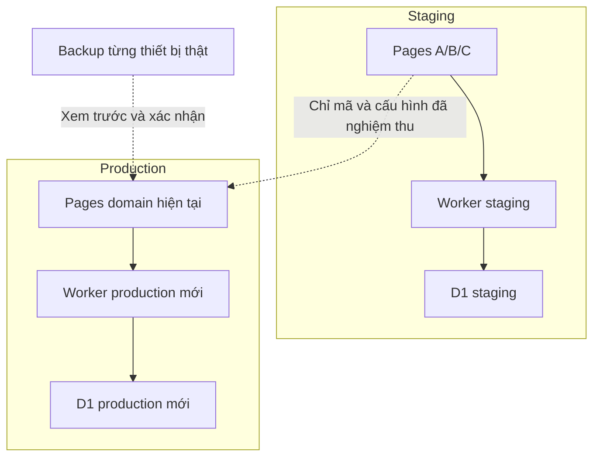

# V2.3 — Production Readiness

Ngày22/11/2026. Baseline `ca71ea794c84c36ecb4d5e654aa140bf927718b9`, nhánh `feature/v2.3-sync-foundation`, PR7 draft.

## Kết luận: NO-GO

Không merge main hoặc production rollout. Đã phục hồi SQL sync staging vào D1 riêng và đối soát chính xác, vá lỗi báo synced giả khi quota đầy; A03 checkpoint/retention vẫn mở. Android/PC thật, dữ liệu lịch sử, prod config/cutover/rollback chưa đủ nghiệm thu.

## Cấu hình thực tế — chỉ đọc

| Thành phần | Kết quả |
|---|---|
| Công Nợ Pages production/main | Commit `e4d6d39b7110f5fc44302aaaac3d26b42cc5f09f`, deployment `f3f53157-2416-432e-89b2-beb975e00d5a`, output`.`/build rỗng |
| version.json tại commit production | `2.1.12-direct-preview`, không phải v2.3 đã phát hành |
| Báo Giá Pages production | Commit `ec021150698753f66e80f59ae2b0ae7bdab45f23`, deployment `61bc40ff-74db-4c1a-956c-5d00a57dd70a`, branch **test/direct-quote-bridge**, output`bao-gia` |
| Sync Worker | Chỉ `tungcnc-sync-v23-staging`, deployment `1af302dd-c24d-4130-9f8d-89a4c6fbeaca`, version `6ab5b540-2922-42eb-9e5a-9fc7b297442f`, source audited `8fd16fc...` |
| Sync D1 binding | DB→`49163cc1-a60d-49b1-9c93-da7a6f939977`, staging |
| Inbox Worker | `tungcnc-quote-inbox-staging`, deployment `b2eae3b1-7cb7-4783-bab3-d3efc5c91e74`, version `03e5b3b0-8b60-4dc9-8938-feb60d21fd83` |
| Inbox binding | D1 `4c5f1ba6-592d-43a6-9d7c-b13fe8cd00fa` và SESSION_SIGNING_KEY; không đọc secret value |
| Production sync Worker/D1 riêng | Chưa có trong inventory nguồn dự án; không tự tạo/bind |
| Client/Worker allowlist sync | Chỉ alias staging A/B/C; merge code hiện tại không tự bật production sync |
| D1 DR mới | `0e536fcd-f683-4dc9-9392-bcd11974a914`, không gắn Worker, không production |

Evidence `storage-production-inventory.json`, GitHub immutable version/index/manifest và Cloudflare APIs. Không đọc dữ liệu thiết bị thật hoặc secret values. Inventory chỉ giới hạn prefix dự án, không chứng nhận toàn account.

## Origin, IndexedDB và PWA

Main/v2.3 cùng DB`tunggiang-congno-v2`, IDBversion1/store`state`/key`main`, fallback`tunggiang-congno-offline-v2`. Manifest id/scope/start_url đều`/`. Giữ nguyên `https://tungcnc-congno.pages.dev/`, browser profile và PWA identity; cập nhật asset không tự xóa IDB/localStorage.

Đây là PASS kiểm tra nguồn, **chưa xác minh trên dữ liệu/thiết bị lịch sử thật**. Không uninstall/Clear Site Data. Branch alias, immutable preview, production/custom domain là origin khác, không chia sẻ IDB dù cùng tên app. Trước chuyển phải xuất từng nguồn riêng.

Manifest staging dùng icon-192/icon-512/icon-maskable-512, production dùng quan-ly-cong-no-* chính thức. Không sửa UI/icon trong nhiệm vụ này; release phải giữ bộ icon đã duyệt, không ghi đè manifest máy móc hoặc đổi id/scope để làm mới icon.

## Staging → production: đề xuất, chưa triển khai

**Không tự copy D1 staging sang production** hoặc import dữ liệu thử. Inbox production cần Worker/D1/secret riêng; không share bảng/secret staging. Hai Pages có nhánh production khác nhau, phải duyệt kế hoạch riêng.

| Quyền | Ranh giới cần chốt |
|---|---|
| Runtime sync | Chỉ bind prod sync D1; device signature/origin đúng môi trường |
| Runtime inbox | Prod inbox D1 +secret mới, role/origin đúng hai app |
| Chủ xưởng | Duyệt/thu hồi đúng device, giữ khóa backup riêng; không gửi token/mật khẩu qua chat |
| Operator/pipeline | Quyền tối thiểu tài nguyên đã duyệt; pipeline staging không được ghi prod DB |
| GitHub | Review/protected-branch policy cần chốt; không auto-merge PR7 |
| DR | Không endpoint; không dùng approvals lịch sử để public database vừa restore |

Chưa cấu hình quyền tối thiểu/branch protection mới; quyền connector hiện tại không chứng minh production pipeline đã cách ly an toàn.

## Kế hoạch cutover

1. Chốt commit/config/checklist đã ký; giữ code/artifact/hash cũ để rollback tương thích. Không coi test mô phỏng là vật lý.
2. Từng origin/browser/thiết bị xuất ZIP app và đối soát sync nếu có pending/conflict; giữ hash, revision/cursor, counts/totals và kiểm tra file thực sự nằm ngoài app. Backup lỗi thì dừng.
3. Nguồn authoritative là kho production chủ xưởng xác định, **không phải staging**. Nếu nhiều kho khác nhau, đối chiếu từng ID/quan hệ/payment; không tự chọn mới hơn, gộp theo tên/SĐT hoặc tạo giao dịch bù.
4. Sau lệnh riêng, tạo prod Worker/D1 trống, secret và allowlist mới; không lấy D1 staging qua config mặc định. Giữ device pending tới khi chủ xưởng duyệt.
5. Cập nhật asset cùng domain/PWA. So local trước bật sync; backup trước first-enable, preview và xác nhận tiếp nhận. Không làm tròn tiền lịch sử để qua điều kiện VND nguyên.
6. Kết nối A rồi B rồi C, không cùng bootstrap từ ba kho chưa đối chiếu. Sau mỗi máy: cùng IDs/counts/phải thu/phải trả/thu/chi/ngày/phân bổ, outbox/cursor và ACK.
7. Chỉ cứu dữ liệu staging nếu chủ xưởng xác định có dữ liệu thật cần chuyển, xuất riêng và duyệt từng bản ghi. Không thực hiện trong nhiệm vụ này.

## Sau phát hành và rollback: chỉ kế hoạch

Xác minh deployment/version/binding/origin/id/scope/IDB, không auto-seed; so IDs/counts/totals trước-sau. Test giao dịch giả trong môi trường riêng được chỉ định, không thêm vào sổ thật. Kiểm tra báo cáo/ZIP/fresh restore/queue/offline/revoke.

Giữ D1 export trước rollout và backup/log mới sau rollout. Sai số dư/trùng payment/chữ ký/ghi đè: dừng sync có kiểm soát, giữ local/outbox. Chưa có global maintenance switch được nghiệm thu; cơ chế fail-closed phải được thiết kế/test trước production.

- Rollback **code** không rollback IDB/D1. Bản code cũ phải đọc được data/meta mới; main cũ có thể không tạo outbox cho thay đổi tiếp theo. Không rollback mù rồi cho phép ghi không theo dõi. Khi chưa có code rollback tương thích, ưu tiên fail-closed sync +forward-fix sau backup.
- Rollback **dữ liệu** không được Time Travel/restore SQL cũ đè D1 có giao dịch mới. Restore database khác, so delta/log/outbox và chủ xưởng xác nhận; lỗ hổng lịch sử không tự suy đoán bù.
- Review lại device approvals/claims khi DR. Database clone chứa trạng thái quyền tại thời điểm backup; không public ngay trước rà soát/re-enrollment.

## Checklist chủ xưởng: Android/PC/PWA

Ghi model/OS/browser/PWA, origin/commit/thời gian, số liệu trước-sau và bằng chứng PASS/FAIL; không test phá hủy trên kho thật.

- [ ] S24 Ultra Chrome/Zalo tải1ZIP, giải nén, hash/Excel9sheet; JSON riêng còn hoạt động.
- [ ] Microsoft Excel PC/Android mở file khi tắt mạng; ID/SĐT/tiền/nhóm phân bổ khớp.
- [ ] Fresh app phục hồi backup lịch sử đã ẩn danh; repeat không trùng; cùngID khác nội dung chặn.
- [ ] Cập nhật PWA cùng origin giữ IDB/localStorage, không uninstall/reset.
- [ ] A tạo đơn nhiều hạng mục/kích thước; B/C nhận; B thu nhiều đợt/nhóm3đơn, ngày cũ và dư nợ đúng.
- [ ] Sửa/backdate/hủy/restore payment và đơn; history/thu tháng này/NCC đúng.
- [ ] Offline tạo/sửa, chuyển app/khóa/kill PWA, mở lại có draft/queue; online chỉ tạo1giao dịch.
- [ ] Hai máy sửa cùng đơn: giữ hai bản, chọn có xác nhận; retry/mấtACK không trùng.
- [ ] Thu hồi device, giữ local/queue và không server write trái phép.
- [ ] Nhắc24h, PNG/PDF/Excel, số dư KH/NCC giữ nguyên; không tự gửi tin.
- [ ] Quota thật: không báo lưu/synced thành công khi ghi lỗi; không mất pending.
- [ ] Backup D1 sync **và inbox**, restore DB mới, không mất delta mới; đo RPO/RTO và mất-provider.
- [ ] Retention dry-run có all-device ACK/backup/rollback; không xóa nghiệp vụ/outbox/conflict.

## Cổng phát hành

| Điều kiện | Hiện tại | Cần làm |
|---|---|---|
| Sync/idempotency/công nợ API và mô phỏng | PASS phạm vi đã test | Nghiệm thu vật lý |
| ZIP/JSON/Excel/SHA/fresh app restore | PASS tự động | S24/Chrome/Zalo và Excel thật sau vá |
| SQL sync D1 full restore riêng | PASS thực tế | Inbox D1 và toàn bộ kịch bản DR |
| Quota false-sync | FAIL trước, PASS mô phỏng sau | Áp lực quota thật |
| A03 checkpoint/retention/ACK | CHƯA TRIỂN KHAI | Implementation/backup/pin/tests trước cleanup |
| Dữ liệu đời đầu/nhiều kho riêng | CHƯA XÁC MINH | Bản ẩn danh và owner review |
| Android/PC/PWA/power-loss | CHƯA KIỂM THỬ đủ | Checklist vật lý |
| Prod config/resources/maintenance/rollback | CHƯA SẴN SÀNG | Tài nguyên riêng, review và diễn tập |
| Bảo mật end-to-end/XSS/account loss | CHƯA AUDIT ĐẦY ĐỦ | Tiếp tục A05/A07; không an toàn tuyệt đối |
| Lệnh phát hành v2.3 của chủ xưởng | CHƯA CÓ | Xác nhận riêng sau nghiệm thu; không dùng lệnh cũ của phiên bản khác |

**NO-GO**. Đọc STORAGE-POLICY.md và DISASTER-RECOVERY-PLAN.md để xem bằng chứng/giới hạn. Báo cáo này không cho phép tự thực thi cutover.
